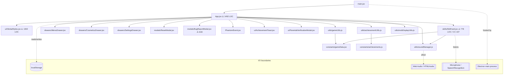

# Technical Debt Register — Level Up RPG (CodeWash)

> Living document. Every refactoring PR references a debt item (`DEBT-xx`).
> Statuses are kept up to date; new debt we discover **or introduce** is added
> here. Metrics are re-measured after each major refactoring — before/after
> numbers are our proof.
>
> **First version — Mid-term baseline.** Captured on 2026-11-10, immediately
> after launching the project and before any refactoring.

---

## 1. Map of the codebase

### 1.1 Module / dependency graph



### 1.2 Where the state lives

All persistent state is in the browser **`localStorage`** (no server). Keys:

| Key | Content |
|---|---|
| `currentProfile_v1` | active profile id (1–3) |
| `heroProfileNames_v1` | `{1,2,3} → name` |
| `heroParentStatus_v1` | `{1,2,3} → bool` parental unlock |
| `heroSkills_v23_p{id}` | per-profile skills blob (level, xp, difficulty, badges, mob state…) |
| `heroSkills_v23` | legacy pre-profile save (migrated into profile 1) |

Runtime (non-persistent) state lives mostly as `useState` in `App.jsx` and
`SkillCard.jsx`.

### 1.3 Where the I/O happens

- **Storage:** `localStorage` read/written directly inside `App.jsx`
  (not isolated — see DEBT-02).
- **Audio:** `utils/soundManager.js` (music + SFX).
- **Speech / microphone:** reading-skill voice input inside `SkillCard.jsx`.
- **Clock / randomness:** `Date`, `Math.random` scattered across utils and
  components (see DEBT-03) — the main obstacle to deterministic tests.
- **Desktop shell:** `electron/main.cjs`.

---

## 2. Baseline metrics (before any refactoring)

Reproduce every number with the commands shown — nothing here is hand-waved.

| Metric | Value | Tool / command |
|---|---|---|
| Source size | **6,938 LOC** across `src/` | `find src -name '*.js*' \| xargs wc -l` |
| Largest files | App.jsx **1492**, GlobalStyles **1302**, SkillCard **778**, gameData 416, gameUtils 363 | same |
| ESLint errors | **0** (was 28, all from junk files — see DEBT-00) | `npm run lint` |
| Functions with cyclomatic complexity > 12 | **11** | `npx eslint src --rule '{"complexity":["warn",12]}'` |
| Worst complexity | `SkillCard.jsx:65` = **107**, `App.jsx:94 (loadSkills)` = 31, `MenuDrawer.jsx:142` = 27, `App.jsx:569` = 24, `CosmeticsDrawer.jsx:108` = 21 | same |
| Test files (as received) | **0** | — |
| Test coverage now | utils under test: **98.5% lines / 100% funcs / 48% branches** | `npm run coverage` (Vitest + v8) |
| CI as received | build-only (`.github/workflows/build-exe.yml`); **no test/lint/coverage gate** | — |

**Not yet measured (tracked as DEBT-09):** code duplication (planned tool:
`jscpd`). Qualitatively, obvious duplication exists: `MenuDrawer.jsx` vs
`MenuDrawer_old.jsx`, and the repeated per-skill mob fields in `App.jsx`
`loadSkills`.

---

## 3. Debt items

Priority: **P1** = do first. Status: `todo` / `in-progress` / `done`.
Effort: S (<½ day) / M (~1 day) / L (multi-day).

| ID | Location | Smell / issue | Impact | Risk if untreated | Effort | Prio | Status |
|---|---|---|---|---|---|---|---|
| DEBT-00 | repo root, `src/**` | 687 macOS `._*` junk files; ESLint parse-errored on them | Lint unusable, repo noise | Masks real lint errors | S | P1 | **done** |
| DEBT-01 | no tests, build-only CI | No safety net, no quality gate on PRs | Any change can silently break the game | Regressions ship to kids | M | P1 | **in-progress** (utils covered; components + CI next) |
| DEBT-02 | `App.jsx` (localStorage reads/writes inline) | I/O not separated from domain; globals | Can't unit-test persistence; fragile migrations | Save corruption, data loss | M | P1 | todo |
| DEBT-03 | `Math.random`, `Date` scattered (gameUtils, SkillCard, App) | Non-injected clock/RNG | Behavior non-deterministic → untestable | Flaky features, hidden bugs | M | P1 | todo |
| DEBT-04 | `SkillCard.jsx:65` (CC **107**, 778 LOC) | God component; one arrow fn does everything | Nobody can safely change combat/skills | Highest-risk hotspot | L | P1 | todo |
| DEBT-05 | `App.jsx` (1492 LOC, `loadSkills` CC 31) | God component; mixed concerns, backward-compat sprawl | Hard to reason about, high coupling | Change ripple, regressions | L | P2 | todo |
| DEBT-06 | `GlobalStyles.jsx` (1302 LOC) | Giant inline style/CSS blob | Styling changes are risky & slow | Theme bugs (see Themes mission) | M | P2 | todo |
| DEBT-07 | `drawers/MenuDrawer_old.jsx` | Dead/duplicated code kept alongside `MenuDrawer.jsx` | Confusion, double maintenance | Edits to wrong file | S | P2 | todo |
| DEBT-08 | `modals/BugReportModal.jsx` (19 LOC stub) | Feature button that does nothing | Users can't report bugs | — (also a chosen mission) | M | P2 | **done** (Bug Reporting mission — see `docs/adr/0002`) |
| DEBT-09 | whole repo | Duplication not yet measured | Unknown hidden duplication | Blind refactors | S | P3 | todo |
| DEBT-10 | content & identifiers | Hardcoded **Minecraft**-themed names/assets | Theming can't fully swap them | IP/branding + Themes mission blocked | M | P3 | todo |
| DEBT-11 | `ow/`, `.packaging/`, `docs/OW-PACKAGING.md` | Out-of-scope rewrite of the game into a custom "OW" language | Dead weight; contradicts refactor mandate | Confuses handover | S | P2 | todo (decide: remove / archive) |
| DEBT-12 | `App.jsx`, `SkillCard.jsx`, drawers | Most in-game strings still hardcoded English | i18n infra exists but coverage of strings is partial | Mixed-language UI until migrated | M | P3 | in-progress (Settings + Bug Report + selector translated; rest incremental) |

> **Note on DEBT-11:** the CodeWash subject is a *legacy refactoring* mission
> (small reversible steps, preserve public contracts). It lists the allowed
> missions (performance, bug reporting, translation, themes, new game) — a
> full rewrite into another language is **not** one of them. The `ow/` port is
> therefore flagged as debt to remove or archive, not to continue.

---

## 4. Risk matrix (impact × likelihood of breaking)

```
IMPACT
  high │ DEBT-02      DEBT-04   DEBT-01
       │ DEBT-03      DEBT-05
  med  │ DEBT-06      DEBT-08   DEBT-07
       │ DEBT-10                DEBT-11
  low  │ DEBT-09                DEBT-00(done)
       └─────────────────────────────────────
          low          med        high   → LIKELIHOOD
```

Top-right (high impact × high likelihood) = treat first: **DEBT-01, DEBT-04**.

---

## 5. Phased attack plan

**Phase 0 — Stop the bleeding (done / in progress)**
1. DEBT-00: remove junk, get lint to 0. ✅
2. DEBT-01: characterization tests on pure utils + CI with quality gates. ⏳

**Phase 1 — Build the safety net wider (P1)**
3. DEBT-03: inject clock & RNG so combat/skills become deterministic & testable.
4. DEBT-02: extract a storage/persistence module from `App.jsx`.
5. Characterization tests for the critical combat flow before touching DEBT-04.

**Phase 2 — Break up the god components (P1/P2)**
6. DEBT-04: carve `SkillCard.jsx` into smaller, tested pieces.
7. DEBT-05: extract state/orchestration out of `App.jsx`.
8. DEBT-06: modularize `GlobalStyles`.

**Phase 3 — Cleanup & features (P2/P3)**
9. DEBT-07: delete `MenuDrawer_old.jsx`. DEBT-11: remove/archive the `ow/` port.
10. DEBT-10: de-hardcode theme content. Then the 4 chosen feature missions
    (each with full test coverage), measuring metrics again after each.

> Re-measure Section 2 after every phase and record the before/after in
> [`CHANGELOG.md`](../CHANGELOG.md).
